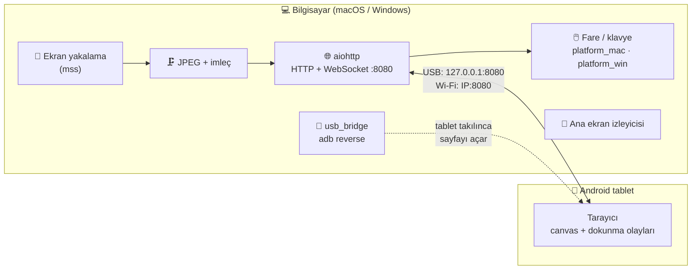
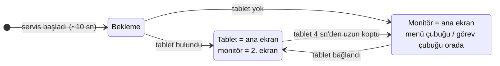

<div align="center">

# 🖥️ Ekran Yansıtıcı

**Ekranı kırık bilgisayarınızı çöpe atmayın — Android tabletinizi ana ekranı yapın.**

Mac veya Windows dizüstünüzün yerleşik ekranını USB kablo ya da Wi-Fi üzerinden tablete yansıtır,<br>
dokunarak kontrol etmenizi sağlar ve harici monitörle ana ekranı otomatik yönetir.

[](LICENSE)
[](https://www.python.org/downloads/)
[](#-macos)
[](#-windows)
[](#tableti-hazırlama)
[](#-katkıda-bulunma)
[](https://github.com/VolkanCARBUGA/ekran-yansitici/stargazers)

[Özellikler](#-özellikler) •
[Nasıl Çalışır](#-nasıl-çalışır) •
[Kurulum](#-kurulum) •
[Kullanım](#-kullanım) •
[Güvenlik](#%EF%B8%8F-güvenlik) •
[SSS](#-sss) •
[Katkı](#-katkıda-bulunma)

</div>

> [!NOTE]
> 🇬🇧 **English:** Ekran Yansıtıcı keeps a laptop with a broken built-in screen usable by mirroring that screen to an Android tablet over **USB (ADB)** or **Wi-Fi**, with full touch control. While the tablet is connected it is the primary display; when it is disconnected, an attached external monitor is promoted to primary automatically. Runs on **macOS and Windows**, needs only Python 3.10+, nothing to install on the tablet (it runs in the browser). MIT licensed.

---

## 📑 İçindekiler

- [Neden?](#-neden)
- [Özellikler](#-özellikler)
- [Nasıl Çalışır](#-nasıl-çalışır)
- [Gereksinimler](#-gereksinimler)
- [Kurulum](#-kurulum)
  - [Tableti hazırlama](#tableti-hazırlama)
  - [macOS](#-macos)
  - [Windows](#-windows)
- [Kullanım](#-kullanım)
- [Yapılandırma](#%EF%B8%8F-yapılandırma)
- [Güvenlik](#%EF%B8%8F-güvenlik)
- [Sorun Giderme](#-sorun-giderme)
- [SSS](#-sss)
- [Proje Yapısı](#-proje-yapısı)
- [Platform Durumu](#-platform-durumu)
- [Yol Haritası](#%EF%B8%8F-yol-haritası)
- [Katkıda Bulunma](#-katkıda-bulunma)
- [Lisans](#-lisans)

---

## 💡 Neden?

Dizüstü bilgisayarın ekranı kırıldığında genelde iki seçenek kalır: pahalı bir panel değişimi ya da bilgisayarı masaya bağlı bir kasaya çevirmek. Ama çoğumuzun çekmecesinde bir **Android tablet** duruyor.

Ekran Yansıtıcı, o tableti bilgisayarın **gerçek ana ekranı** gibi kullanmanızı sağlar:

- **Tak ve kullan:** Kabloyu takarsınız, görüntü gelir, dokunarak çalışırsınız.
- **Harici monitörle uyumlu:** Masaya oturup monitöre bağlandığınızda ve tableti çıkardığınızda, menü çubuğu / görev çubuğu kendiliğinden monitöre geçer. Kırık ekranda kaybolan pencerelerle uğraşmazsınız.

## ✨ Özellikler

| | Özellik | Açıklama |
|---|---|---|
| 🔌 | **USB ile tak-çalıştır** | Tablet takılınca ADB tüneli kurulur ve tablette tarayıcı kendiliğinden açılır. Bilgisayarda hiçbir şeye tıklamanız gerekmez. |
| 📡 | **Wi-Fi** | Aynı ağdaki tablette `http://<bilgisayar-ip>:8080` adresini açmanız yeterli. |
| 🔀 | **Akıllı ana ekran** | Tablet bağlıyken ana ekran tablettir. Tablet çıkınca harici monitör ana ekran olur. Ekranların birbirine göre yerleşimi korunur. |
| 👆 | **Dokunmatik kontrol** | Tek dokunma, çift dokunma, uzun basma (sağ tık), sürükle-bırak |
| 🔍 | **Yakınlaştırma** | İki parmakla %100–%400 arası yakınlaştırıp kaydırma |
| ⚡ | **Düşük gecikme** | 60 FPS'e kadar, 4:2:0 JPEG, canlı fare imleci |
| 📱 | **Tablete kurulum yok** | Tarayıcıda çalışır, tam ekran düğmesi vardır, PWA olarak ana ekrana eklenebilir. |
| 🔁 | **Arka plan servisi** | Açılışta kendiliğinden başlar, çökerse yeniden başlar, yayın sürerken uykuyu engeller. |
| 🪶 | **Hafif** | 4 Python bağımlılığı. Platform kodu saf `ctypes` ile yazılmıştır, derleme gerekmez. |

## 🧠 Nasıl Çalışır



**Ana ekranın nasıl seçildiği:** Sunucu her saniye bir **açık tablet oturumu** ya da **ADB'ye bağlı bir USB cihazı** olup olmadığına bakar. Kısa kopmalarda ekran gidip gelmesin diye 4 saniye bekler.



Ana ekranı değiştirmek için hedef ekran (0,0) noktasına getirilir ve diğer ekranlar aynı miktarda kaydırılır:

- **macOS:** `CGConfigureDisplayOrigin`
- **Windows:** `ChangeDisplaySettingsEx` + `CDS_SET_PRIMARY`

Harici monitör yoksa (tek ekran) ana ekrana dokunulmaz.

## 📋 Gereksinimler

| | macOS | Windows |
|---|---|---|
| **İşletim sistemi** | macOS 12+ | Windows 10 / 11 |
| **Python** | 3.10+ ([python.org](https://www.python.org/downloads/), pyenv veya Homebrew) | 3.10+ ([python.org](https://www.python.org/downloads/), kurulumda **"Add python.exe to PATH"** işaretli olmalı) |
| **ADB** (yalnızca USB için) | `brew install android-platform-tools` | [Platform Tools](https://developer.android.com/tools/releases/platform-tools) indirilip PATH'e eklenmeli |
| **Tablet** | Android, Chrome önerilir | Android, Chrome önerilir |

Python bağımlılıkları kurulum sırasında sanal ortama (venv) otomatik kurulur: `aiohttp`, `mss`, `pillow`, `pynput`.

## 🚀 Kurulum

```bash
git clone https://github.com/VolkanCARBUGA/ekran-yansitici.git
cd ekran-yansitici
```

> [!TIP]
> Ekran tamamen görünmüyorsa kurulumu aşağıdaki yollardan biriyle yapabilirsiniz. Bir kez kurulduktan sonra servis her açılışta kendiliğinden başlar.
> - Harici bir monitör bağlayarak
> - Ekran paylaşımıyla (macOS: *Ekran Paylaşımı / VNC*, Windows: *Uzak Masaüstü*)
> - Başka bir bilgisayardan SSH ile

### Tableti hazırlama

USB bağlantısı için bu adımlar bir kez yapılır. Yalnızca Wi-Fi kullanacaksanız atlayabilirsiniz.

1. **Ayarlar → Tablet hakkında** bölümünde *Yapı numarası*na 7 kez dokunun.
2. **Ayarlar → Geliştirici seçenekleri** altında **USB hata ayıklama**yı açın.
3. Tableti bilgisayara takın ve tablette çıkan *"USB hata ayıklamaya izin ver"* sorusuna **Her zaman izin ver** deyin.

### 🍎 macOS

```bash
./OTOMATIK_BASLATMA_KUR.command      # arka plan servisi olarak kur (önerilen)
./BASLAT.command                     # veya yalnızca bu oturum için çalıştır
```

<details>
<summary><b>Kurulum ne yapar?</b></summary>

1. Dosyaları `~/Library/Application Support/EkranYansitici` altına kopyalar.
2. Orada bir sanal ortam (venv) oluşturup bağımlılıkları kurar.
3. Bir LaunchAgent (`com.ekranyansitici.server`) ekler: servis girişte başlar, kapanırsa yeniden başlatılır.
4. Sunucuyu doğrudan `Python.app` ile çalıştırır. Böylece macOS izinleri bir kabuk betiğine değil Python'a verilir.

Belirli bir Python kullanmak için: `EKRAN_PYTHON=/yol/python3 ./OTOMATIK_BASLATMA_KUR.command`
</details>

**İzinler:** İlk çalıştırmada **Sistem Ayarları → Gizlilik ve Güvenlik** altında iki izin verilmelidir:

| İzin | Ne için |
|---|---|
| **Ekran Kaydı** | Bu izin olmadan görüntü yakalanamaz (siyah ekran). |
| **Erişilebilirlik** | Bu izin olmadan dokunmatik / fare kontrolü çalışmaz. |

İzni verilecek uygulama, kurulumun sonunda **"Çalıştırıcı"** olarak yazdırılan `Python.app`'tir. İzinleri verdikten sonra kurulumu bir kez daha çalıştırın.

**Kaldırma:** `./OTOMATIK_BASLATMA_KUR.command --kaldir`

### 🪟 Windows

`OTOMATIK_BASLATMA_KUR.bat` dosyasına çift tıklayın (önerilen). Yalnızca bu oturum için `BASLAT.bat` yeterlidir.

<details>
<summary><b>Kurulum ne yapar?</b></summary>

1. Dosyaları `%LOCALAPPDATA%\EkranYansitici` altına kopyalar.
2. Orada bir sanal ortam (venv) oluşturup bağımlılıkları kurar.
3. **Başlangıç** klasörüne gizli çalışan bir başlatıcı (`EkranYansitici.vbs`) koyar: sunucu oturum açılışında başlar, kapanırsa 3 saniye sonra yeniden başlatılır.
4. Loglar `%LOCALAPPDATA%\EkranYansitici\logs\server.log` dosyasına yazılır.
</details>

> [!IMPORTANT]
> - **Güvenlik duvarı:** İlk açılışta Windows Güvenlik Duvarı izin isteyebilir. Wi-Fi bağlantısı için *Özel ağlar*a izin verin. USB bağlantısı bu izin olmadan da çalışır.
> - **Yönetici pencereleri:** Windows, yönetici olarak çalışan pencerelere normal bir uygulamanın fare olayı göndermesini engeller. Bu pencereleri dokunmatikle kullanmanız gerekiyorsa sunucuyu yönetici olarak başlatın.

**Kaldırma:** `OTOMATIK_BASLATMA_KUR.bat --kaldir`

## 🎮 Kullanım

1. **USB:** Servis kuruluyken tableti takın. Sayfa tablette kendiliğinden açılır.
2. **Wi-Fi:** Tablet tarayıcısında, sunucu başlarken yazdırılan `http://<IP>:8080` adresini açın.
3. **Harici monitör:** Monitör takılıyken tableti çıkarın, ana ekran yaklaşık 4 saniye içinde monitöre geçer. Tableti geri takınca tekrar tablete döner.

### Dokunmatik hareketler

| Hareket | Bilgisayardaki karşılığı |
|---|---|
| 👆 Tek dokunma | Sol tık |
| 👆👆 Çift dokunma | Çift tık |
| ✋ Uzun basma | Sağ tık |
| ☝️ Sürükleme | Sürükle-bırak / seçim |
| 🤏 İki parmak | Yakınlaştırma (%100–%400) ve kaydırma |
| ⛶ Sağ alt düğme | Tam ekran / çıkış |

### Ekran senaryoları

| Bağlı olanlar | Ana ekran | 2. ekran |
|---|---|---|
| Yalnızca tablet | Yerleşik ekran (tablette görünür) | — |
| Tablet + monitör | Yerleşik ekran (tablette görünür) | Harici monitör |
| Yalnızca monitör | Harici monitör | Yerleşik (kırık) ekran |

## ⚙️ Yapılandırma

```bash
python app/server.py [--port 8080] [--monitor 1] [--fps 60] [--quality 78] [--no-auto-main]
```

| Seçenek | Varsayılan | Açıklama |
|---|---|---|
| `--port` | `8080` | HTTP / WebSocket portu |
| `--monitor` | `1` | Yansıtılacak ekranın sırası. Yerleşik ekran her zaman `1`'dir. |
| `--fps` | `60` | Hedef kare hızı |
| `--quality` | `78` | JPEG kalitesi (1–95) |
| `--no-auto-main` | kapalı | Ana ekranı tablete göre otomatik değiştirmeyi kapatır |

| Ortam değişkeni | Açıklama |
|---|---|
| `EKRAN_PYTHON` | macOS kurulumunda kullanılacak `python3` yolu |

## 🛡️ Güvenlik

> [!WARNING]
> Sunucu ağdaki tüm arayüzlerde **parolasız** dinler. **Aynı Wi-Fi ağındaki herkes** `http://<IP>:8080` adresini açarak ekranınızı görebilir ve fare/klavyeyi kontrol edebilir.

- ✅ Yalnızca güvendiğiniz ağlarda (ev ağı gibi) Wi-Fi kullanın.
- ✅ Halka açık ağlarda yalnızca **USB** kullanın. USB bağlantısı `127.0.0.1` üzerinden ADB tüneliyle gider.
- ✅ Wi-Fi'ı tamamen kapatmak için güvenlik duvarında 8080 portuna dışarıdan erişimi engelleyin.

Bir güvenlik açığı bulursanız lütfen herkese açık bir issue yerine GitHub'ın [özel güvenlik bildirimi](https://github.com/VolkanCARBUGA/ekran-yansitici/security/advisories/new) özelliğini kullanın.

## 🔧 Sorun Giderme

| Belirti | Çözüm |
|---|---|
| Siyah ekran / `Ekran yakalama hatası` (macOS) | `Python.app`'e **Ekran Kaydı** izni verin, kurulumu yeniden çalıştırın. |
| Görüntü var ama dokunma çalışmıyor (macOS) | `Python.app`'e **Erişilebilirlik** izni verin. |
| Tablet takılınca sayfa açılmıyor | `adb devices` çıktısında cihazın `device` durumunda olduğunu kontrol edin. Tablette USB hata ayıklama iznini onaylayın. |
| `ADB: Yok` yazıyor | ADB kurulu değil ya da PATH'te değil. Bkz. [Gereksinimler](#-gereksinimler). |
| Wi-Fi'dan bağlanılamıyor | Tablet ve bilgisayarın aynı ağda olduğundan ve güvenlik duvarının 8080 portuna izin verdiğinden emin olun. |
| Windows'ta tıklamalar kaymış | Ekran ölçeklemesi (%125/%150) kaynaklı olabilir. Sorun sürerse ölçekleme oranınızla birlikte bir issue açın. |
| Ana ekran değişmiyor | Kapak kapalıyken (clamshell) yerleşik ekran listede görünmez. Loglarda `Ana ekran →` satırlarına bakın. |

**Log dosyaları**

- macOS: `~/Library/Logs/EkranYansitici/server.log`
- Windows: `%LOCALAPPDATA%\EkranYansitici\logs\server.log`

## ❓ SSS

<details>
<summary><b>Tablete bir uygulama kurmam gerekiyor mu?</b></summary>

Hayır. Her şey tabletin tarayıcısında çalışır. İsterseniz Chrome menüsünden *Ana ekrana ekle* diyerek uygulama gibi açabilirsiniz.
</details>

<details>
<summary><b>iPad ile çalışır mı?</b></summary>

Wi-Fi üzerinden çalışması beklenir, çünkü arayüz standart bir web sayfasıdır. USB ile otomatik açılma ise ADB'ye dayandığı için yalnızca Android'de çalışır.
</details>

<details>
<summary><b>Gecikme ne kadar?</b></summary>

USB'de gecikme genellikle Wi-Fi'dan düşüktür. Wi-Fi'da ağın kalitesine bağlıdır. `--quality` ve `--fps` değerlerini düşürmek zayıf ağlarda akıcılığı artırır.
</details>

<details>
<summary><b>Ses de aktarılıyor mu?</b></summary>

Hayır, yalnızca görüntü ve kontrol aktarılır. Ses bilgisayardan çıkmaya devam eder.
</details>

<details>
<summary><b>Otomatik ana ekran değişimini istemiyorum.</b></summary>

Sunucuyu `--no-auto-main` ile başlatın. Servis olarak kullanıyorsanız bu bayrağı LaunchAgent (macOS) veya `.vbs` başlatıcı (Windows) komutuna ekleyin.
</details>

<details>
<summary><b>Masaüstü bilgisayarda (yerleşik ekranı olmayan) kullanabilir miyim?</b></summary>

Yansıtma çalışır, `--monitor` ile hangi ekranın yansıtılacağını seçebilirsiniz. Otomatik ana ekran özelliği ise yerleşik bir panel aradığı için devreye girmez.
</details>

## 📁 Proje Yapısı

```text
ekran-yansitici/
├── BASLAT.command               # macOS — manuel başlatıcı
├── BASLAT.bat                   # Windows — manuel başlatıcı
├── OTOMATIK_BASLATMA_KUR.command# macOS — LaunchAgent servis kurulumu
├── OTOMATIK_BASLATMA_KUR.bat    # Windows — Başlangıç klasörü servis kurulumu
├── LICENSE
└── app/
    ├── server.py                # HTTP + WebSocket sunucusu, ekran yakalama, ana ekran izleyicisi
    ├── platform_layer.py        # İşletim sistemine göre denetleyici seçimi
    ├── platform_mac.py          # macOS: CoreGraphics fare / ekran / ana ekran, caffeinate
    ├── platform_win.py          # Windows: SendInput, QueryDisplayConfig, ChangeDisplaySettingsEx
    ├── usb_bridge.py            # ADB izleme, adb reverse, tablette tarayıcıyı açma
    ├── macos_python.sh          # macOS Python / venv seçimi
    ├── windows_install.ps1      # Windows kurulum betiği
    ├── requirements.txt
    └── web/                     # Tablet arayüzü
        ├── index.html
        ├── app.js               # WebSocket, canvas çizimi, dokunma hareketleri, zoom
        ├── style.css
        └── manifest.json        # PWA
```

## 🧪 Platform Durumu

| Platform | Durum | Not |
|---|---|---|
| macOS | ✅ Kararlı | Günlük kullanımda test edildi: USB, Wi-Fi, harici monitörle otomatik ana ekran |
| Windows | 🧪 Deneysel | Yeni eklendi, gerçek donanımda henüz geniş çaplı test edilmedi |
| Linux | ❌ Desteklenmiyor | Katkılara açık. Bkz. [Katkıda Bulunma](#-katkıda-bulunma) |

Windows'ta bir sorunla karşılaşırsanız lütfen **Windows sürümünüzü**, **ekran ölçeklemenizi** ve **`server.log` içeriğini** ekleyerek bir [issue açın](https://github.com/VolkanCARBUGA/ekran-yansitici/issues/new).

## 🗺️ Yol Haritası

- [ ] Wi-Fi bağlantısı için PIN / parola koruması
- [ ] Tablette ekran klavyesi ve kısayol çubuğu
- [ ] Linux desteği (X11 / Wayland)
- [ ] H.264 / WebCodecs ile daha düşük bant genişliği
- [ ] Tableti yansıtma yerine ayrı bir 2. ekran olarak kullanma (sanal ekran)

Bir fikriniz mi var? [Issue açın](https://github.com/VolkanCARBUGA/ekran-yansitici/issues) veya tartışmaya katılın.

## 🤝 Katkıda Bulunma

Katkılarınızı bekliyoruz. Hata bildirimi, öneri, belge düzeltmesi ve kod katkısının hepsi değerli.

1. Depoyu **fork**'layın.
2. Bir dal oluşturun: `git checkout -b ozellik/harika-fikir`
3. Değişikliklerinizi yapıp commit'leyin: `git commit -m "Harika fikir eklendi"`
4. Dalınızı gönderin: `git push origin ozellik/harika-fikir`
5. Bir **Pull Request** açın.

**Geliştirme notları**

- Platforma özel kodlar `app/platform_mac.py` ve `app/platform_win.py` dosyalarındadır. İkisi aynı arayüzü sağlamalıdır; arayüzün listesi `app/platform_layer.py` dosyasının başında yazılıdır.
- Yeni bir platform eklemek için bu arayüzü uygulayan bir `platform_<os>.py` yazıp `platform_layer.py` içinde seçtirmeniz yeterlidir.
- Sunucuyu servis olmadan, doğrudan terminalde çalıştırmak hata ayıklamayı kolaylaştırır: `./BASLAT.command` veya `BASLAT.bat`.

## 📄 Lisans

Bu proje [MIT Lisansı](LICENSE) ile lisanslanmıştır. Dilediğiniz gibi kullanabilir, değiştirebilir ve dağıtabilirsiniz.

<div align="center">

---

Faydalı bulduysanız bir ⭐ bırakmayı unutmayın!

Made with ❤️ by [Volkan Çarbuğa](https://github.com/VolkanCARBUGA)

</div>
