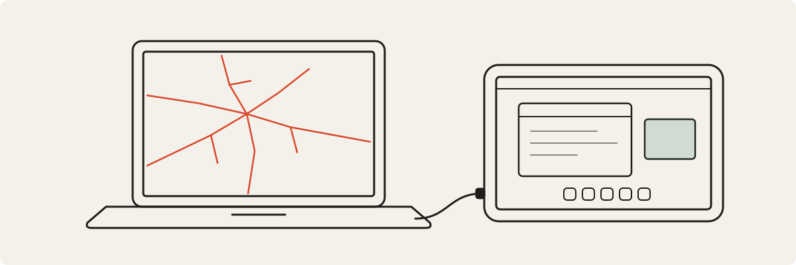
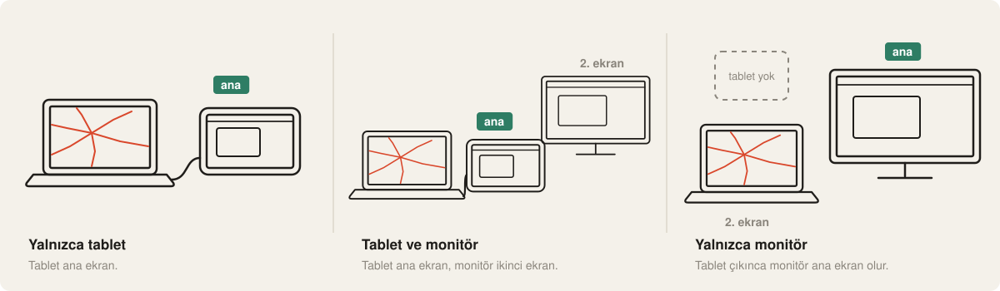

# Ekran Yansıtıcı

[](LICENSE)
[](https://www.python.org/downloads/)
[](#kurulum)

Ekranı kırık bir dizüstü bilgisayarın görüntüsünü Android tablete aktarır ve tabletten dokunarak kullanmanızı sağlar. Tablet USB kablo ya da Wi-Fi ile bağlanır, tablete uygulama kurmak gerekmez: görüntü tarayıcıda açılır.

Ekranı kırık bir MacBook'u kullanmaya devam etmek için yazıldı, sonradan Windows desteği eklendi.

<p align="center">
  
</p>

**English:** mirrors a laptop's built-in screen to an Android tablet over USB (ADB) or Wi-Fi, with touch input. While the tablet is connected it is the primary display; when you unplug it, an external monitor becomes primary. macOS and Windows, Python 3.10+, MIT.

## Ne yapar

- Tablet USB ile takılınca `adb reverse` tünelini kurar ve tablette sayfayı kendisi açar.
- Aynı ağdaysanız Wi-Fi üzerinden de bağlanabilirsiniz. Bu durumda 6 haneli bir PIN sorulur.
- Dokunmalar fareye çevrilir:
  - Dokunma → tık
  - Çift dokunma → çift tık
  - Uzun basma → sağ tık
  - Sürükleme → sürükle-bırak
  - İki parmak → yakınlaştırma
- Harici monitör takılıysa ana ekranı (menü çubuğu, Dock, görev çubuğu) tablete göre değiştirir. Ayrıntısı aşağıda.
- Servis olarak kurulur. Açılışta başlar, kapanırsa yeniden başlar.

## Ana ekran nasıl seçilir

Kırık ekranda menü çubuğunun ya da yeni açılan pencerelerin kaybolmaması için ana ekran, tablete göre otomatik değişir:

<p align="center">
  
</p>

| Bağlı olanlar | Ana ekran | İkinci ekran |
|---|---|---|
| Yalnızca tablet | Tablet | — |
| Tablet ve monitör | Tablet | Monitör |
| Yalnızca monitör | Monitör | Kırık ekran |

Tablet bağlantısı 4 saniyeden uzun koparsa ana ekran monitöre geçer. Böylece kısa kopmalarda ekran gidip gelmez. Ekranların birbirine göre yerleşimi korunur. Bu davranışı `--no-auto-main` ile kapatabilirsiniz.

## Gereksinimler

- **Bilgisayar:** macOS 12+ veya Windows 10/11
- **Python 3.10+:** Windows'ta kurulum sırasında "Add python.exe to PATH" işaretli olmalı.
- **ADB (yalnızca USB için):**
  - macOS: `brew install android-platform-tools`
  - Windows: [Platform Tools](https://developer.android.com/tools/releases/platform-tools) indirilip PATH'e eklenmeli.
- **Tablet:** Android, Chrome önerilir.

Tableti USB ile kullanacaksanız bir kez USB hata ayıklamayı açmanız gerekir:

1. **Ayarlar → Tablet hakkında** bölümünde **Yapı numarası**na yedi kez dokunun.
2. **Geliştirici seçenekleri** altında **USB hata ayıklama**yı açın.
3. Tableti ilk taktığınızda çıkan izin sorusuna **Her zaman izin ver** deyin.

## Kurulum

```bash
git clone https://github.com/VolkanCARBUGA/ekran-yansitici.git
cd ekran-yansitici
```

Ekran hiç görünmüyorsa bu adımları harici bir monitörle, ekran paylaşımıyla (VNC / Uzak Masaüstü) ya da SSH ile yapabilirsiniz. Bir kez kurduktan sonra servis kendiliğinden başlar.

### macOS

```bash
./OTOMATIK_BASLATMA_KUR.command   # servis olarak kur
./BASLAT.command                  # ya da yalnızca şimdilik çalıştır
```

Kurulum:

- dosyaları `~/Library/Application Support/EkranYansitici` altına kopyalar,
- bir sanal ortam (venv) oluşturur,
- bir LaunchAgent ekler.

İlk çalıştırmada **Sistem Ayarları → Gizlilik ve Güvenlik** altında iki izin vermeniz gerekir:

- **Ekran Kaydı:** Bu izin olmadan görüntü siyah gelir.
- **Erişilebilirlik:** Bu izin olmadan dokunma çalışmaz.

İzin verilecek uygulama, kurulumun sonunda "Çalıştırıcı" olarak yazdırılan `Python.app`'tir. İzinleri verdikten sonra kurulumu bir kez daha çalıştırın.

Kaldırmak için: `./OTOMATIK_BASLATMA_KUR.command --kaldir`

### Windows

`OTOMATIK_BASLATMA_KUR.bat` dosyasını çalıştırın. Yalnızca bu oturum için `BASLAT.bat` yeterlidir.

Kurulum:

- dosyaları `%LOCALAPPDATA%\EkranYansitici` altına kopyalar,
- bir sanal ortam oluşturur,
- Başlangıç klasörüne gizli çalışan bir başlatıcı koyar.

Loglar `%LOCALAPPDATA%\EkranYansitici\logs\server.log` dosyasındadır.

Bilinmesi gereken iki şey:

- **Güvenlik duvarı:** İlk açılışta izin isteyebilir. Wi-Fi için **Özel ağlar**a izin verin; USB bu izin olmadan da çalışır.
- **Yönetici pencereleri:** Windows, normal bir uygulamanın yönetici olarak çalışan pencerelere tıklama göndermesine izin vermez. Bu pencereleri dokunmatikle kullanmanız gerekiyorsa sunucuyu yönetici olarak başlatın.

Kaldırmak için: `OTOMATIK_BASLATMA_KUR.bat --kaldir`

## Kullanım

**USB:** Servis kuruluyken tableti takın. Sayfa birkaç saniye içinde tablette açılır.

**Wi-Fi:** Tablette, sunucunun başlarken yazdırdığı `http://<ip>:8080` adresini açın ve PIN'i girin. Tablet PIN'i hatırlar, bir dahaki sefere sormaz.

Sağ alttaki düğmeler:

- **Tam ekran:** tam ekrana geçer ya da çıkar.
- **Yüzde göstergesi:** yakınlaştırmayı sıfırlar.
- **Kilit (yalnızca USB'de görünür):** Wi-Fi PIN'ini on saniye gösterir.

## PIN ve güvenlik

Sunucu bütün ağ arayüzlerinde dinler. Bu yüzden Wi-Fi'dan gelen bağlantılar PIN girilene kadar ne görüntü alır ne de dokunma gönderebilir. USB bağlantıları `127.0.0.1` üzerinden geldiği için PIN sorulmaz: tabletin kabloyla takılı olması ve bilgisayara USB hata ayıklama izni vermiş olması gerekir.

- **PIN'in üretilmesi:** İlk çalıştırmada rastgele üretilir ve ayar dosyasına kaydedilir. Servisi yeniden kurmak PIN'i değiştirmez.
  - macOS: `~/.config/ekran-yansitici/ayarlar.json`
  - Windows: `%APPDATA%\EkranYansitici\ayarlar.json`
- **PIN'i görmek:** Ekran kırıkken PIN'i USB'ye bağlı tabletteki kilit düğmesinden ya da log dosyasından görebilirsiniz.
- **Hatırlanması:** Doğru PIN'den sonra tablet bir jeton saklar. `--reset-pin` ile PIN değişince eski jetonlar geçersiz olur.
- **Deneme kilidi:** Aynı IP'den beş yanlış denemede 30 saniye kilit uygulanır. Yanlışlar sürerse süre her seferinde ikiye katlanır, en fazla 15 dakika olur.

PIN yabancıların bağlanmasını engeller, ama bağlantı şifrelenmez (düz HTTP). Halka açık ağlarda USB kullanın.

Bir güvenlik açığı bulursanız lütfen herkese açık bir issue yerine [özel olarak bildirin](https://github.com/VolkanCARBUGA/ekran-yansitici/security/advisories/new).

## Seçenekler

```
python app/server.py [--port 8080] [--monitor 1] [--fps 60] [--quality 78]
                     [--no-auto-main] [--pin PIN] [--reset-pin] [--no-pin]
```

| Seçenek | Açıklama |
|---|---|
| `--port` | Port (varsayılan 8080) |
| `--monitor` | Yansıtılacak ekranın sırası. Yerleşik ekran her zaman 1'dir. |
| `--fps` | Hedef kare hızı (varsayılan 60) |
| `--quality` | JPEG kalitesi, 1–95 (varsayılan 78) |
| `--no-auto-main` | Ana ekranı otomatik değiştirmez |
| `--pin` | Bu çalıştırma için PIN'i belirler (kaydedilmez). `EKRAN_PIN` ortam değişkeni de olur. |
| `--reset-pin` | Yeni bir PIN üretip kaydeder |
| `--no-pin` | PIN korumasını kapatır. Aynı ağdaki herkes bağlanabilir hale gelir. |

macOS'ta belirli bir Python kullanmak için kurulumu `EKRAN_PYTHON=/yol/python3 ./OTOMATIK_BASLATMA_KUR.command` şeklinde çalıştırın.

## Sorun giderme

| Sorun | Çözüm |
|---|---|
| Görüntü siyah (macOS) | `Python.app`'e Ekran Kaydı izni verip kurulumu yeniden çalıştırın. |
| Görüntü var, dokunma çalışmıyor (macOS) | `Python.app`'e Erişilebilirlik izni verin. |
| Tablet takılınca sayfa açılmıyor | `adb devices` çıktısında cihaz `device` olarak görünmeli. Tablette USB hata ayıklama iznini onaylayın. |
| Logda `ADB: Yok` yazıyor | ADB kurulu değil ya da PATH'te değil. |
| PIN'i bilmiyorum | Tableti USB ile bağlayıp kilit düğmesine dokunun ya da loga bakın. Yeni PIN için bir kez `--reset-pin` ile çalıştırın. |
| Windows'ta tıklamalar kayıyor | Büyük ihtimalle ekran ölçeklemesinden (%125/%150) kaynaklanıyor. Ölçekleme oranınızı yazarak bir issue açın. |
| Ana ekran değişmiyor | Kapak kapalıyken yerleşik ekran görünmez. Logda `Ana ekran →` satırlarına bakın. |

**Log dosyaları:**

- macOS: `~/Library/Logs/EkranYansitici/server.log`
- Windows: `%LOCALAPPDATA%\EkranYansitici\logs\server.log`

## Nasıl çalışır

Sunucu (`app/server.py`) yerleşik ekranı [mss](https://github.com/BoboTiG/python-mss) ile yakalar, JPEG'e çevirip imleci üstüne çizer ve WebSocket üzerinden tablete gönderir. Tablet görüntüyü bir canvas'a çizer, dokunmaları geri yollar. Sunucu da bunları işletim sisteminin fare olaylarına çevirir.

İşletim sistemine özel kısımlar iki dosyadadır. İkisi de `ctypes` ile yazıldı, derlenmesi gereken bir bağımlılık yok:

- `app/platform_mac.py`: CoreGraphics ile fare olayları, ekran listesi ve ana ekran değiştirme
- `app/platform_win.py`: Aynı işler Win32 ile: `SendInput`, `QueryDisplayConfig`, `ChangeDisplaySettingsEx`

Diğer dosyalar:

- `app/usb_bridge.py`: ADB'yi izler, tablet takılınca tüneli kurup tarayıcıyı açar.
- `app/pin_auth.py`: PIN, jeton ve deneme kilidi.
- `app/web/`: Tablette açılan arayüz.

## Durum

macOS'ta günlük kullanımda test edildi. Windows desteği yeni ve henüz gerçek donanımda pek denenmedi. Sorun yaşarsanız Windows sürümünüzü, ekran ölçeklemenizi ve `server.log` içeriğini ekleyerek [issue açın](https://github.com/VolkanCARBUGA/ekran-yansitici/issues/new).

Planlananlar:

- Wi-Fi bağlantısını HTTPS ile şifrelemek
- Tablette ekran klavyesi
- Linux desteği

## Katkı

Issue ve pull request'ler açıktır. Platforma özel bir değişiklik yaparsanız iki platform dosyasının aynı fonksiyonları sağlamaya devam etmesi gerekir. Bu fonksiyonların listesi `app/platform_layer.py` dosyasının başında yazılıdır.

Geliştirirken sunucuyu servis yerine `./BASLAT.command` (veya `BASLAT.bat`) ile terminalde çalıştırmak hataları görmeyi kolaylaştırır.

## Lisans

[MIT](LICENSE)
