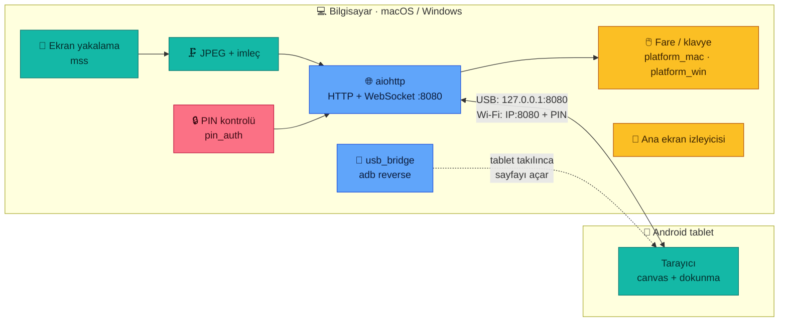
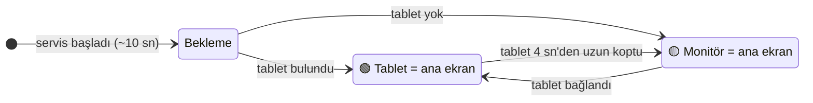

<a id="readme-top"></a>

<div align="center">




<br>

[](https://github.com/VolkanCARBUGA/ekran-yansitici/stargazers)
[](https://github.com/VolkanCARBUGA/ekran-yansitici/network/members)
[](https://github.com/VolkanCARBUGA/ekran-yansitici/issues)
[](https://github.com/VolkanCARBUGA/ekran-yansitici/commits/main)
[](LICENSE)

[](https://www.python.org/downloads/)
[](#-macos)
[](#-windows)
[](#-tableti-hazırlama)
[](https://docs.aiohttp.org/)

<h3>
  <a href="#-hızlı-başlangıç">🚀 Hızlı Başlangıç</a>
  <span> · </span>
  <a href="#-özellikler">✨ Özellikler</a>
  <span> · </span>
  <a href="#-nasıl-çalışır">🧠 Nasıl Çalışır</a>
  <span> · </span>
  <a href="#%EF%B8%8F-güvenlik">🛡️ Güvenlik</a>
  <span> · </span>
  <a href="#-sss">❓ SSS</a>
</h3>

**Bu projeyi faydalı bulduysanız sağ üstten bir ⭐ vererek destek olabilirsiniz!**

</div>

> [!NOTE]
> 🇬🇧 **English:** Ekran Yansıtıcı keeps a laptop with a broken built-in screen usable by mirroring that screen to an Android tablet over **USB (ADB)** or **Wi-Fi**, with full touch control. While the tablet is connected it is the primary display; when it is disconnected, an attached external monitor is promoted to primary automatically. Wi-Fi connections are protected by a PIN. Runs on **macOS and Windows**, needs only Python 3.10+, and nothing has to be installed on the tablet. MIT licensed.

<details>
<summary><b>📑 İçindekiler</b></summary>

- [💡 Neden?](#-neden)
- [✨ Özellikler](#-özellikler)
- [🖼️ Ekran Senaryoları](#%EF%B8%8F-ekran-senaryoları)
- [🧠 Nasıl Çalışır](#-nasıl-çalışır)
- [🚀 Hızlı Başlangıç](#-hızlı-başlangıç)
- [📋 Gereksinimler](#-gereksinimler)
- [📦 Kurulum](#-kurulum)
- [🎮 Kullanım](#-kullanım)
- [⚙️ Yapılandırma](#%EF%B8%8F-yapılandırma)
- [🛡️ Güvenlik](#%EF%B8%8F-güvenlik)
- [🔧 Sorun Giderme](#-sorun-giderme)
- [❓ SSS](#-sss)
- [📁 Proje Yapısı](#-proje-yapısı)
- [🧪 Platform Durumu](#-platform-durumu)
- [🗺️ Yol Haritası](#%EF%B8%8F-yol-haritası)
- [🤝 Katkıda Bulunma](#-katkıda-bulunma)
- [⭐ Yıldız Geçmişi](#-yıldız-geçmişi)
- [📄 Lisans](#-lisans)

</details>

---

## 💡 Neden?

Dizüstü bilgisayarın ekranı kırıldığında genelde iki seçenek kalır: pahalı bir panel değişimi ya da bilgisayarı masaya bağlı bir kasaya çevirmek. Oysa çoğumuzun çekmecesinde bir **Android tablet** duruyor.

**Ekran Yansıtıcı** o tableti bilgisayarın **gerçek ana ekranı** gibi kullanmanızı sağlar:

- **Tak ve kullan:** Kabloyu takarsınız, görüntü gelir, dokunarak çalışırsınız.
- **Harici monitörle uyumlu:** Masaya oturup tableti çıkardığınızda menü çubuğu / görev çubuğu kendiliğinden monitöre geçer. Kırık ekranda kaybolan pencerelerle uğraşmazsınız.

<p align="right"><a href="#readme-top">⬆️ Başa dön</a></p>

## ✨ Özellikler

<table>
  <tr>
    <td width="33%" valign="top">
      <h3>🔌 USB tak-çalıştır</h3>
      Tablet takılınca ADB tüneli kurulur, tablette tarayıcı kendiliğinden açılır. Bilgisayarda tek tıklama bile gerekmez.
    </td>
    <td width="33%" valign="top">
      <h3>📡 Wi-Fi</h3>
      Aynı ağdaki tablette <code>http://&lt;ip&gt;:8080</code> adresini açın, PIN'i girin ve kullanmaya başlayın.
    </td>
    <td width="33%" valign="top">
      <h3>🔀 Akıllı ana ekran</h3>
      Tablet bağlıyken tablet, tablet yokken harici monitör ana ekran olur. Ekranların yerleşimi korunur.
    </td>
  </tr>
  <tr>
    <td width="33%" valign="top">
      <h3>👆 Dokunmatik kontrol</h3>
      Tek dokunma, çift dokunma, uzun basma (sağ tık) ve sürükle-bırak bilgisayardaki fare hareketlerine dönüşür.
    </td>
    <td width="33%" valign="top">
      <h3>🔍 Yakınlaştırma</h3>
      İki parmakla %100–%400 arası yakınlaştırıp kaydırabilirsiniz. Küçük yazılar artık sorun değil.
    </td>
    <td width="33%" valign="top">
      <h3>🔒 PIN koruması</h3>
      Wi-Fi bağlantıları 6 haneli PIN ister, 5 yanlış denemede kilitlenir. USB'de PIN sorulmaz.
    </td>
  </tr>
  <tr>
    <td width="33%" valign="top">
      <h3>⚡ Düşük gecikme</h3>
      60 FPS'e kadar, 4:2:0 JPEG ve canlı fare imleci.
    </td>
    <td width="33%" valign="top">
      <h3>📱 Tablete kurulum yok</h3>
      Tarayıcıda çalışır, tam ekran desteği vardır, PWA olarak ana ekrana eklenebilir.
    </td>
    <td width="33%" valign="top">
      <h3>🔁 Arka plan servisi</h3>
      Açılışta kendiliğinden başlar, çökerse yeniden başlar, yayın sürerken bilgisayarın uyumasını engeller.
    </td>
  </tr>
</table>

<p align="right"><a href="#readme-top">⬆️ Başa dön</a></p>

## 🖼️ Ekran Senaryoları

<div align="center">
  
</div>

| Bağlı olanlar | 🟢 Ana ekran | 🟡 2. ekran |
|---|---|---|
| Yalnızca tablet | Yerleşik ekran (tablette görünür) | — |
| Tablet + monitör | Yerleşik ekran (tablette görünür) | Harici monitör |
| Yalnızca monitör | Harici monitör | Yerleşik (kırık) ekran |

<p align="right"><a href="#readme-top">⬆️ Başa dön</a></p>

## 🧠 Nasıl Çalışır



**Ana ekranın nasıl seçildiği:** Sunucu her saniye bir **açık tablet oturumu** ya da **ADB'ye bağlı bir USB cihazı** olup olmadığına bakar. Kısa kopmalarda ekran gidip gelmesin diye 4 saniye bekler.



Ana ekranı değiştirmek için hedef ekran (0,0) noktasına getirilir ve diğer ekranlar aynı miktarda kaydırılır:

- **macOS:** `CGConfigureDisplayOrigin`
- **Windows:** `ChangeDisplaySettingsEx` + `CDS_SET_PRIMARY`

Harici monitör yoksa (tek ekran) ana ekrana dokunulmaz.

<p align="right"><a href="#readme-top">⬆️ Başa dön</a></p>

## 🚀 Hızlı Başlangıç

```bash
git clone https://github.com/VolkanCARBUGA/ekran-yansitici.git
cd ekran-yansitici
```

| | 🍎 macOS | 🪟 Windows |
|---|---|---|
| **Servis olarak kur** (önerilen) | `./OTOMATIK_BASLATMA_KUR.command` | `OTOMATIK_BASLATMA_KUR.bat` |
| **Yalnızca bu oturum** | `./BASLAT.command` | `BASLAT.bat` |
| **Kaldır** | `./OTOMATIK_BASLATMA_KUR.command --kaldir` | `OTOMATIK_BASLATMA_KUR.bat --kaldir` |

Ardından tableti USB ile takın, sayfa kendiliğinden açılır. 🎉

## 📋 Gereksinimler

| | 🍎 macOS | 🪟 Windows |
|---|---|---|
| **İşletim sistemi** | macOS 12+ | Windows 10 / 11 |
| **Python** | 3.10+ ([python.org](https://www.python.org/downloads/), pyenv veya Homebrew) | 3.10+ ([python.org](https://www.python.org/downloads/), kurulumda **"Add python.exe to PATH"** işaretli olmalı) |
| **ADB** (yalnızca USB için) | `brew install android-platform-tools` | [Platform Tools](https://developer.android.com/tools/releases/platform-tools) indirilip PATH'e eklenmeli |
| **Tablet** | Android, Chrome önerilir | Android, Chrome önerilir |

Python bağımlılıkları kurulum sırasında sanal ortama (venv) otomatik kurulur: `aiohttp`, `mss`, `pillow`, `pynput`.

## 📦 Kurulum

> [!TIP]
> Ekran tamamen görünmüyorsa kurulumu aşağıdaki yollardan biriyle yapabilirsiniz. Bir kez kurulduktan sonra servis her açılışta kendiliğinden başlar.
> - Harici bir monitör bağlayarak
> - Ekran paylaşımıyla (macOS: *Ekran Paylaşımı / VNC*, Windows: *Uzak Masaüstü*)
> - Başka bir bilgisayardan SSH ile

### 📱 Tableti hazırlama

USB bağlantısı için bu adımlar bir kez yapılır. Yalnızca Wi-Fi kullanacaksanız atlayabilirsiniz.

1. **Ayarlar → Tablet hakkında** bölümünde *Yapı numarası*na **7 kez** dokunun.
2. **Ayarlar → Geliştirici seçenekleri** altında **USB hata ayıklama**yı açın.
3. Tableti bilgisayara takın ve tablette çıkan *"USB hata ayıklamaya izin ver"* sorusuna **Her zaman izin ver** deyin.

### 🍎 macOS

```bash
./OTOMATIK_BASLATMA_KUR.command
```

<details>
<summary><b>Kurulum ne yapar?</b></summary>

1. Dosyaları `~/Library/Application Support/EkranYansitici` altına kopyalar.
2. Orada bir sanal ortam (venv) oluşturup bağımlılıkları kurar.
3. Bir LaunchAgent (`com.ekranyansitici.server`) ekler: servis girişte başlar, kapanırsa yeniden başlatılır.
4. Sunucuyu doğrudan `Python.app` ile çalıştırır. Böylece macOS izinleri bir kabuk betiğine değil Python'a verilir.

Belirli bir Python kullanmak için: `EKRAN_PYTHON=/yol/python3 ./OTOMATIK_BASLATMA_KUR.command`
</details>

**İzinler:** İlk çalıştırmada **Sistem Ayarları → Gizlilik ve Güvenlik** altında iki izin verilmelidir:

| İzin | Ne için |
|---|---|
| 🎥 **Ekran Kaydı** | Bu izin olmadan görüntü yakalanamaz (siyah ekran). |
| ♿ **Erişilebilirlik** | Bu izin olmadan dokunmatik / fare kontrolü çalışmaz. |

İzni verilecek uygulama, kurulumun sonunda **"Çalıştırıcı"** olarak yazdırılan `Python.app`'tir. İzinleri verdikten sonra kurulumu bir kez daha çalıştırın.

### 🪟 Windows

`OTOMATIK_BASLATMA_KUR.bat` dosyasına çift tıklayın.

<details>
<summary><b>Kurulum ne yapar?</b></summary>

1. Dosyaları `%LOCALAPPDATA%\EkranYansitici` altına kopyalar.
2. Orada bir sanal ortam (venv) oluşturup bağımlılıkları kurar.
3. **Başlangıç** klasörüne gizli çalışan bir başlatıcı (`EkranYansitici.vbs`) koyar: sunucu oturum açılışında başlar, kapanırsa 3 saniye sonra yeniden başlatılır.
4. Loglar `%LOCALAPPDATA%\EkranYansitici\logs\server.log` dosyasına yazılır.
</details>

> [!IMPORTANT]
> - **Güvenlik duvarı:** İlk açılışta Windows Güvenlik Duvarı izin isteyebilir. Wi-Fi bağlantısı için *Özel ağlar*a izin verin. USB bağlantısı bu izin olmadan da çalışır.
> - **Yönetici pencereleri:** Windows, yönetici olarak çalışan pencerelere normal bir uygulamanın fare olayı göndermesini engeller. Bu pencereleri dokunmatikle kullanmanız gerekiyorsa sunucuyu yönetici olarak başlatın.

<p align="right"><a href="#readme-top">⬆️ Başa dön</a></p>

## 🎮 Kullanım

1. **🔌 USB:** Servis kuruluyken tableti takın. Sayfa tablette kendiliğinden açılır.
2. **📡 Wi-Fi:** Tablet tarayıcısında, sunucu başlarken yazdırılan `http://<IP>:8080` adresini açın ve **PIN**'i girin. PIN bir kez girildikten sonra tablet onu hatırlar.
3. **🖥️ Harici monitör:** Monitör takılıyken tableti çıkarın, ana ekran yaklaşık 4 saniye içinde monitöre geçer. Tableti geri takınca tekrar tablete döner.

### 👆 Dokunmatik hareketler

| Hareket | Bilgisayardaki karşılığı |
|---|---|
| 👆 Tek dokunma | Sol tık |
| 👆👆 Çift dokunma | Çift tık |
| ✋ Uzun basma | Sağ tık |
| ☝️ Sürükleme | Sürükle-bırak / seçim |
| 🤏 İki parmak | Yakınlaştırma (%100–%400) ve kaydırma |
| ⛶ Sağ alt düğme | Tam ekran / çıkış |
| 🔒 Sağ alt düğme (yalnızca USB) | Wi-Fi PIN'ini 10 saniye gösterir |

<p align="right"><a href="#readme-top">⬆️ Başa dön</a></p>

## ⚙️ Yapılandırma

```bash
python app/server.py [--port 8080] [--monitor 1] [--fps 60] [--quality 78] [--no-auto-main]
                     [--pin 123456] [--reset-pin] [--no-pin]
```

| Seçenek | Varsayılan | Açıklama |
|---|---|---|
| `--port` | `8080` | HTTP / WebSocket portu |
| `--monitor` | `1` | Yansıtılacak ekranın sırası. Yerleşik ekran her zaman `1`'dir. |
| `--fps` | `60` | Hedef kare hızı |
| `--quality` | `78` | JPEG kalitesi (1–95) |
| `--no-auto-main` | kapalı | Ana ekranı tablete göre otomatik değiştirmeyi kapatır |
| `--pin` | — | Wi-Fi PIN'ini bu değerle değiştirir (ayar dosyasına kaydedilmez) |
| `--reset-pin` | — | Yeni rastgele PIN üretip kaydeder. Eski PIN ile eşleşmiş tabletler yeniden PIN ister. |
| `--no-pin` | kapalı | PIN korumasını kapatır (**önerilmez**) |

| Ortam değişkeni | Açıklama |
|---|---|
| `EKRAN_PYTHON` | macOS kurulumunda kullanılacak `python3` yolu |
| `EKRAN_PIN` | `--pin` ile aynı: PIN'i ortam değişkeniyle verir |

**📄 Ayar dosyası** (PIN ve jeton anahtarı burada saklanır; servisi yeniden kurmak PIN'i değiştirmez):

- macOS: `~/.config/ekran-yansitici/ayarlar.json`
- Windows: `%APPDATA%\EkranYansitici\ayarlar.json`

<p align="right"><a href="#readme-top">⬆️ Başa dön</a></p>

## 🛡️ Güvenlik

Sunucu ağdaki tüm arayüzlerde dinler, bu yüzden **Wi-Fi bağlantıları PIN ile korunur**.

| | 🔌 USB (`127.0.0.1`, ADB tüneli) | 📡 Wi-Fi (`<IP>:8080`) |
|---|---|---|
| **PIN sorulur mu?** | Hayır. Kablo fiziksel erişim demektir. | ✅ Evet |
| **Doğrulanmadan görüntü / kontrol** | — | ❌ Yok: PIN girilene kadar ne görüntü gönderilir ne de dokunma işlenir. |

**🔐 PIN nasıl çalışır?**

- **Oluşturulması:** İlk çalıştırmada rastgele **6 haneli** bir PIN üretilir ve [ayar dosyasına](#%EF%B8%8F-yapılandırma) kaydedilir.
- **Hatırlanması:** Doğru PIN girilince tablete bir **jeton** verilir, tablet sonraki bağlantılarda PIN sormaz. Jeton PIN'e bağlıdır; `--reset-pin` ile PIN değişince eski jetonların hepsi geçersiz olur.
- **Deneme kilidi:** Aynı IP'den **5 yanlış denemede** 30 saniye kilit uygulanır. Yanlışlar sürerse kilit süresi her seferinde iki katına çıkar (en çok 15 dakika).
- **API koruması:** `/api/info` da Wi-Fi'dan jetonsuz çağrılırsa `401` döner.

**👀 Ekranım kırıkken PIN'i nasıl göreceğim?**

1. Tableti **USB** ile bağlayın (PIN sorulmaz).
2. Sağ alttaki **🔒** düğmesine dokunun. PIN 10 saniye görünür.
3. Ayrıca sunucu başlarken PIN log dosyasına yazılır (`🔒 Wi-Fi PIN : ...`).

> [!WARNING]
> - PIN, ağı dinleyen birine karşı şifreleme sağlamaz: bağlantı HTTP üzerinden gider. Wi-Fi'ı yalnızca güvendiğiniz ağlarda (ev ağı gibi) kullanın, halka açık ağlarda **USB** kullanın.
> - `--no-pin` ile korumayı kapatırsanız aynı ağdaki herkes ekranınızı görebilir ve bilgisayarınızı kontrol edebilir.

> [!CAUTION]
> Bir güvenlik açığı bulursanız lütfen herkese açık bir issue açmayın. Bunun yerine GitHub'ın [özel güvenlik bildirimi](https://github.com/VolkanCARBUGA/ekran-yansitici/security/advisories/new) özelliğini kullanın.

<p align="right"><a href="#readme-top">⬆️ Başa dön</a></p>

## 🔧 Sorun Giderme

| Belirti | Çözüm |
|---|---|
| ⬛ Siyah ekran / `Ekran yakalama hatası` (macOS) | `Python.app`'e **Ekran Kaydı** izni verin, kurulumu yeniden çalıştırın. |
| 🚫 Görüntü var ama dokunma çalışmıyor (macOS) | `Python.app`'e **Erişilebilirlik** izni verin. |
| 🔌 Tablet takılınca sayfa açılmıyor | `adb devices` çıktısında cihazın `device` durumunda olduğunu kontrol edin. Tablette USB hata ayıklama iznini onaylayın. |
| ❔ `ADB: Yok` yazıyor | ADB kurulu değil ya da PATH'te değil. Bkz. [Gereksinimler](#-gereksinimler). |
| 🔑 PIN'i bilmiyorum / unuttum | Tableti USB ile bağlayıp 🔒 düğmesine dokunun, ya da log dosyasına bakın. Yeni PIN için sunucuyu bir kez `--reset-pin` ile çalıştırın. |
| ⏳ `Çok fazla yanlış deneme` | Gösterilen süre kadar bekleyin. Kilit IP başınadır ve sunucu yeniden başlayınca sıfırlanır. |
| 📡 Wi-Fi'dan bağlanılamıyor | Tablet ve bilgisayarın aynı ağda olduğundan ve güvenlik duvarının 8080 portuna izin verdiğinden emin olun. |
| 🎯 Windows'ta tıklamalar kaymış | Ekran ölçeklemesi (%125/%150) kaynaklı olabilir. Sorun sürerse ölçekleme oranınızla birlikte bir issue açın. |
| 🔀 Ana ekran değişmiyor | Kapak kapalıyken (clamshell) yerleşik ekran listede görünmez. Loglarda `Ana ekran →` satırlarına bakın. |

**📜 Log dosyaları**

- macOS: `~/Library/Logs/EkranYansitici/server.log`
- Windows: `%LOCALAPPDATA%\EkranYansitici\logs\server.log`

<p align="right"><a href="#readme-top">⬆️ Başa dön</a></p>

## ❓ SSS

<details>
<summary><b>📱 Tablete bir uygulama kurmam gerekiyor mu?</b></summary>

Hayır. Her şey tabletin tarayıcısında çalışır. İsterseniz Chrome menüsünden *Ana ekrana ekle* diyerek uygulama gibi açabilirsiniz.
</details>

<details>
<summary><b>🍏 iPad ile çalışır mı?</b></summary>

Wi-Fi üzerinden çalışması beklenir, çünkü arayüz standart bir web sayfasıdır. USB ile otomatik açılma ise ADB'ye dayandığı için yalnızca Android'de çalışır.
</details>

<details>
<summary><b>🔌 USB'de neden PIN sorulmuyor?</b></summary>

USB bağlantısı ADB tüneliyle bilgisayarın kendi içinden (`127.0.0.1`) gelir. Tabletin bu yolla bağlanabilmesi için kabloyla takılı olması ve bilgisayara USB hata ayıklama izni vermiş olması gerekir; yani fiziksel erişim zaten vardır. Bu sayede kırık ekranlı bilgisayarda tak-çalıştır akışı bozulmaz.
</details>

<details>
<summary><b>⚡ Gecikme ne kadar?</b></summary>

USB'de gecikme genellikle Wi-Fi'dan düşüktür. Wi-Fi'da ağın kalitesine bağlıdır. `--quality` ve `--fps` değerlerini düşürmek zayıf ağlarda akıcılığı artırır.
</details>

<details>
<summary><b>🔊 Ses de aktarılıyor mu?</b></summary>

Hayır, yalnızca görüntü ve kontrol aktarılır. Ses bilgisayardan çıkmaya devam eder.
</details>

<details>
<summary><b>🔀 Otomatik ana ekran değişimini istemiyorum.</b></summary>

Sunucuyu `--no-auto-main` ile başlatın. Servis olarak kullanıyorsanız bu bayrağı LaunchAgent (macOS) veya `.vbs` başlatıcı (Windows) komutuna ekleyin.
</details>

<details>
<summary><b>🖥️ Masaüstü bilgisayarda (yerleşik ekranı olmayan) kullanabilir miyim?</b></summary>

Yansıtma çalışır, `--monitor` ile hangi ekranın yansıtılacağını seçebilirsiniz. Otomatik ana ekran özelliği ise yerleşik bir panel aradığı için devreye girmez.
</details>

<p align="right"><a href="#readme-top">⬆️ Başa dön</a></p>

## 📁 Proje Yapısı

```text
ekran-yansitici/
├── 🍎 BASLAT.command                # macOS — manuel başlatıcı
├── 🪟 BASLAT.bat                    # Windows — manuel başlatıcı
├── 🍎 OTOMATIK_BASLATMA_KUR.command # macOS — LaunchAgent servis kurulumu
├── 🪟 OTOMATIK_BASLATMA_KUR.bat     # Windows — Başlangıç klasörü servis kurulumu
├── 📄 LICENSE
├── 🖼️ docs/assets/                  # README görselleri (SVG)
└── 📦 app/
    ├── server.py                    # HTTP + WebSocket sunucusu, ekran yakalama, ana ekran izleyicisi
    ├── platform_layer.py            # İşletim sistemine göre denetleyici seçimi
    ├── platform_mac.py              # macOS: CoreGraphics fare / ekran / ana ekran, caffeinate
    ├── platform_win.py              # Windows: SendInput, QueryDisplayConfig, ChangeDisplaySettingsEx
    ├── usb_bridge.py                # ADB izleme, adb reverse, tablette tarayıcıyı açma
    ├── pin_auth.py                  # Wi-Fi PIN koruması, jeton ve deneme kilidi
    ├── macos_python.sh              # macOS Python / venv seçimi
    ├── windows_install.ps1          # Windows kurulum betiği
    ├── requirements.txt
    └── web/                         # Tablet arayüzü
        ├── index.html
        ├── app.js                   # WebSocket, PIN ekranı, canvas çizimi, dokunma, zoom
        ├── style.css
        └── manifest.json            # PWA
```

## 🧪 Platform Durumu

| Platform | Durum | Not |
|---|---|---|
| 🍎 macOS |  | Günlük kullanımda test edildi: USB, Wi-Fi, PIN, harici monitörle otomatik ana ekran |
| 🪟 Windows |  | Yeni eklendi, gerçek donanımda henüz geniş çaplı test edilmedi |
| 🐧 Linux |  | Katkılara açık. Bkz. [Katkıda Bulunma](#-katkıda-bulunma) |

Windows'ta bir sorunla karşılaşırsanız lütfen **Windows sürümünüzü**, **ekran ölçeklemenizi** ve **`server.log` içeriğini** ekleyerek bir [issue açın](https://github.com/VolkanCARBUGA/ekran-yansitici/issues/new).

## 🗺️ Yol Haritası

- [x] macOS desteği
- [x] Windows desteği (deneysel)
- [x] Harici monitörle otomatik ana ekran
- [x] Wi-Fi bağlantısı için PIN koruması
- [ ] Wi-Fi bağlantısını HTTPS/WSS ile şifreleme
- [ ] Tablette ekran klavyesi ve kısayol çubuğu
- [ ] Linux desteği (X11 / Wayland)
- [ ] H.264 / WebCodecs ile daha düşük bant genişliği
- [ ] Tableti yansıtma yerine ayrı bir 2. ekran olarak kullanma (sanal ekran)

Bir fikriniz mi var? [Issue açın](https://github.com/VolkanCARBUGA/ekran-yansitici/issues) ve birlikte konuşalım. 💬

<p align="right"><a href="#readme-top">⬆️ Başa dön</a></p>

## 🤝 Katkıda Bulunma

Katkılarınızı bekliyoruz! Hata bildirimi, öneri, belge düzeltmesi ve kod katkısının hepsi değerli. 💛

1. Depoyu **fork**'layın.
2. Bir dal oluşturun: `git checkout -b ozellik/harika-fikir`
3. Değişikliklerinizi yapıp commit'leyin: `git commit -m "Harika fikir eklendi"`
4. Dalınızı gönderin: `git push origin ozellik/harika-fikir`
5. Bir **Pull Request** açın.

<details>
<summary><b>🛠️ Geliştirme notları</b></summary>

- Platforma özel kodlar `app/platform_mac.py` ve `app/platform_win.py` dosyalarındadır. İkisi aynı arayüzü sağlamalıdır; arayüzün listesi `app/platform_layer.py` dosyasının başında yazılıdır.
- Yeni bir platform eklemek için bu arayüzü uygulayan bir `platform_<os>.py` yazıp `platform_layer.py` içinde seçtirmeniz yeterlidir.
- Sunucuyu servis olmadan, doğrudan terminalde çalıştırmak hata ayıklamayı kolaylaştırır: `./BASLAT.command` veya `BASLAT.bat`.
</details>

### 👥 Katkıda bulunanlar

<a href="https://github.com/VolkanCARBUGA/ekran-yansitici/graphs/contributors">
  
</a>

## ⭐ Yıldız Geçmişi

<a href="https://star-history.com/#VolkanCARBUGA/ekran-yansitici&Date">
  <picture>
    <source media="(prefers-color-scheme: dark)" srcset="https://api.star-history.com/svg?repos=VolkanCARBUGA/ekran-yansitici&type=Date&theme=dark">
    
  </picture>
</a>

## 📄 Lisans

Bu proje [MIT Lisansı](LICENSE) ile lisanslanmıştır. Dilediğiniz gibi kullanabilir, değiştirebilir ve dağıtabilirsiniz.

<div align="center">

<br>

**Faydalı bulduysanız ⭐ vermeyi ve paylaşmayı unutmayın!**

Made with ❤️ by [Volkan Çarbuğa](https://github.com/VolkanCARBUGA)


</div>
